## 🚀 Live Demo

- **Live Application:** https://socialmedia-frontend-fawn.vercel.app/
- **Frontend Repository:** https://github.com/saurabh-op/socialmediaFrontend
- **Backend Repository:** https://github.com/saurabh-op/socialMediaBackend

> **Note:** The backend is hosted on a free-tier service, so the first Login/Sign Up request may take a few seconds while the server wakes up.

## 🛠️ Tech Stack

## 📖 Overview

A modern full-stack social media platform designed to deliver a seamless and interactive user experience through secure media sharing, personalized feeds, and real-time communication. The application enables users to connect, share content, interact through likes, discover other users, and exchange instant messages while demonstrating production-oriented software engineering practices.

Built with **React**, **Spring Boot**, and **MongoDB**, the platform follows a layered backend architecture (Controllers, Services, and Repositories) with **45+ RESTful APIs**. **WebSockets (STOMP + SockJS)** power real-time messaging, while **AWS S3** securely stores media assets and MongoDB manages application data and metadata.

To optimize performance, images are cropped and compressed on the client before upload. The project demonstrates practical experience in designing and deploying a scalable full-stack application with cloud storage integration, real-time communication, and clean backend architecture.

## 🏗️ System Architecture

The application follows a client-server architecture with separate frontend and backend services. The frontend communicates with the backend through REST APIs for standard operations and WebSockets for real-time messaging.The crucial post-upload and **content delivery** and **real-time messaging** pipelines **are explained below**.

| Component | Responsibility |
|-----------|----------------|
| **React + Vite Frontend** | User interface, routing, state management, API integration |
| **Spring Boot Backend** | Business logic, authentication, REST APIs, WebSocket server |
| **MongoDB Atlas** | Stores users, posts, chats, notifications, and metadata |
| **AWS S3** | Stores profile images and post media |
| **JWT Authentication** | Secures protected API endpoints |
| **WebSocket (STOMP + SockJS)** | Enables real-time chat and instant message delivery |

### General Request Flow

1. User performs an action in the React frontend.
2. Frontend sends a REST API request to the Spring Boot backend.
4. Data is stored or retrieved from MongoDB.
5. Images are uploaded to AWS S3, while only their URLs are stored in MongoDB.
6. Backend returns the response to the frontend.
7. For chat, WebSocket connections deliver messages instantly without polling.

## 1.  📤 Post Upload & Content Delivery Flow

The post publishing pipeline is orchestrated by the **Post Dispatcher**, which coordinates media storage, metadata persistence, feed generation, notifications, and real-time updates. Instead of directly storing media in the database, images are uploaded to **AWS S3**, while only their metadata and media references are persisted in **MongoDB**.

  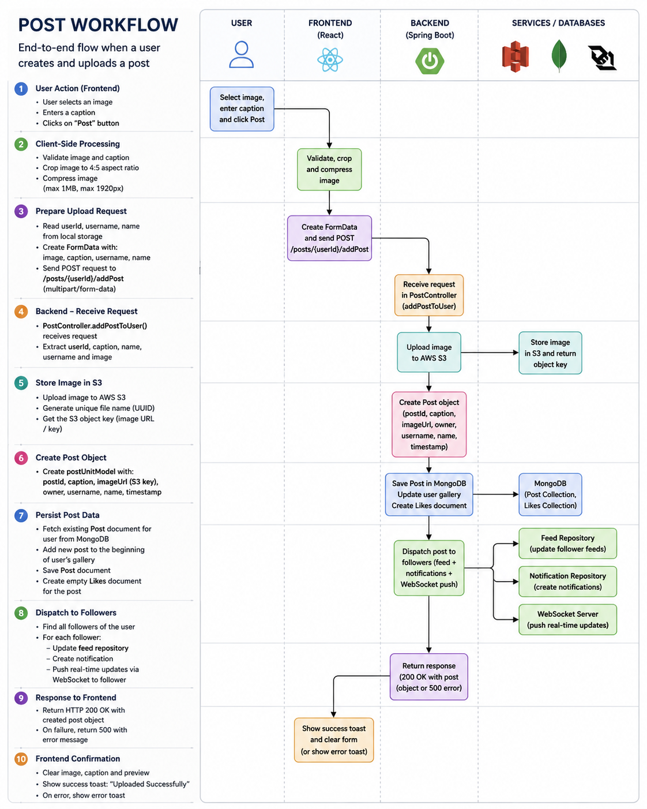

### Why this approach?

- Client-side image compression before upload
- Scalable media storage using AWS S3
- Lightweight MongoDB documents storing only metadata and media references
- Centralized orchestration through the **Post Dispatcher**
- Automatic feed generation for followers
- Real-time notifications using WebSockets (STOMP + SockJS)
- Automatic initialization of likes metadata for every new post
- Event-driven architecture that can be extended for analytics, moderation, or recommendation services

## 2.  💬 Real-Time Chat Pipeline

The messaging system combines **REST APIs**, **MongoDB**, and **WebSockets (STOMP + SockJS)** to provide reliable message persistence with instant real-time delivery. Messages are first stored in the database and then pushed to subscribed clients over WebSockets.

  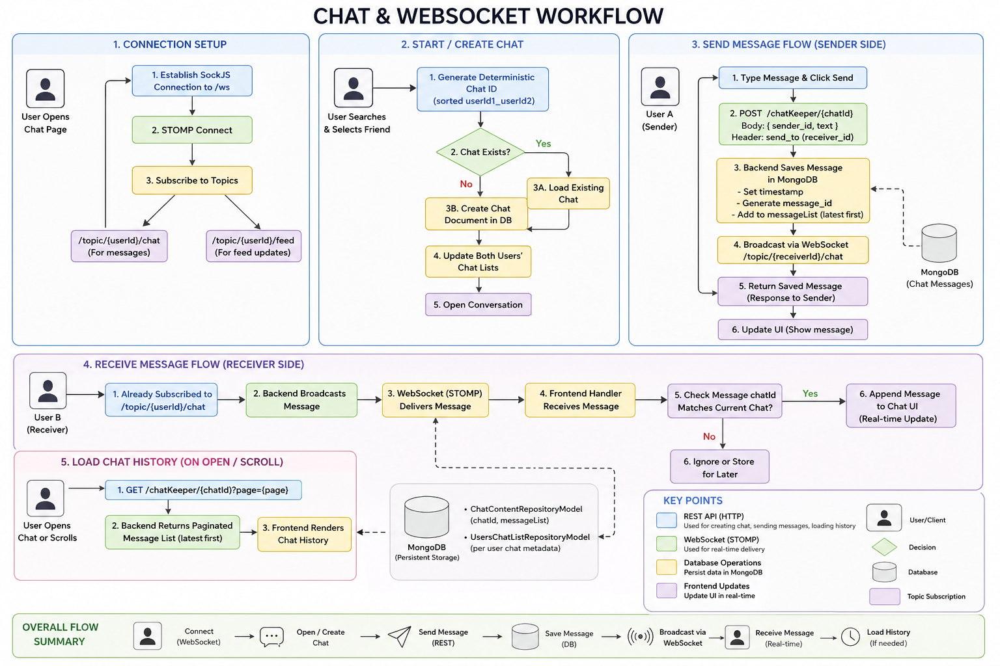

### Why This Approach?

- Ensures reliable message delivery by persisting data before broadcasting.
- Uses persistent WebSocket connections for low-latency communication.
- Deterministic chat IDs prevent duplicate conversations between users.
- Supports offline users through persistent MongoDB chat history.
- Clean separation of responsibilities between REST (storage) and WebSockets (real-time delivery).

## Additional Workflows

| Workflow | Overview |
|----------|----------|
| ❤️ **Like System** | • Like/unlike posts with a single click. • Like metadata is updated in MongoDB. • UI reflects changes immediately. 
| 📰 **Feed Generation** | • Personalized feeds are maintained for every user. • Feed Dispatcher propagates newly published posts. • Connected users receive live feed updates. |
| 🔍 **User Search** | • Search users by username. • Results update dynamically as users type. • Direct navigation to user profiles. |
| 👤 **Profile Management** | • Update profile details and profile picture. • Images are stored in AWS S3 and metadata in MongoDB. • Changes are reflected across the platform. |
| 👥 **Follow System** | • Follow or unfollow other users. • Relationships are stored in MongoDB. • New posts are propagated through the Feed Dispatcher. |

## 🗄️ MongoDB Collection Design
| **Chat Repository** | **Feed Repository** |
|:-------------------:|:-------------------:|
| 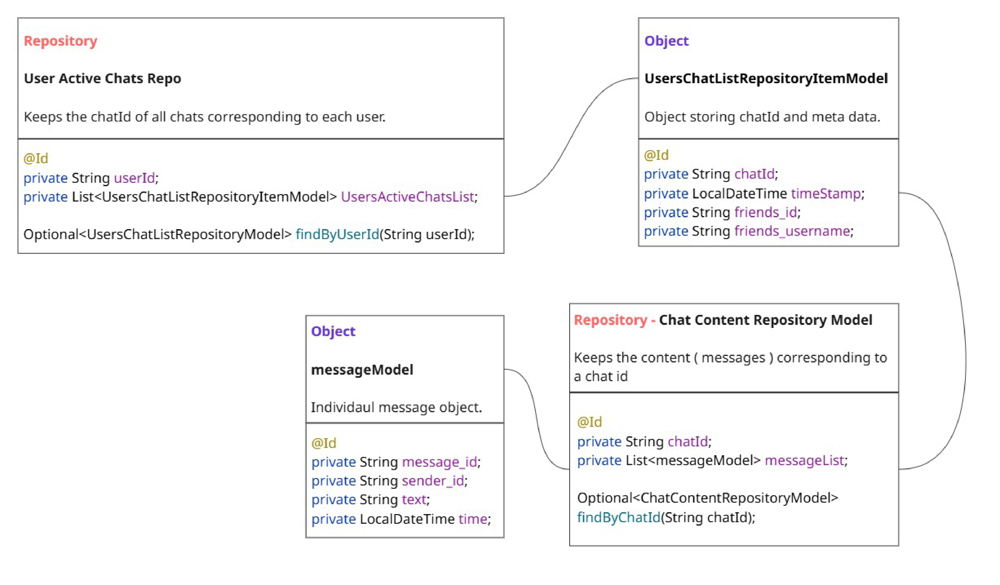 | 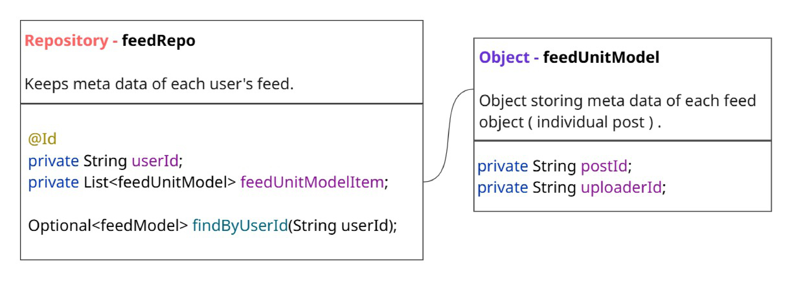 |
| **User Repository** | **Media Repository** |
| 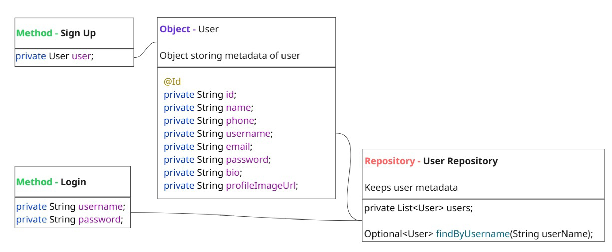 | 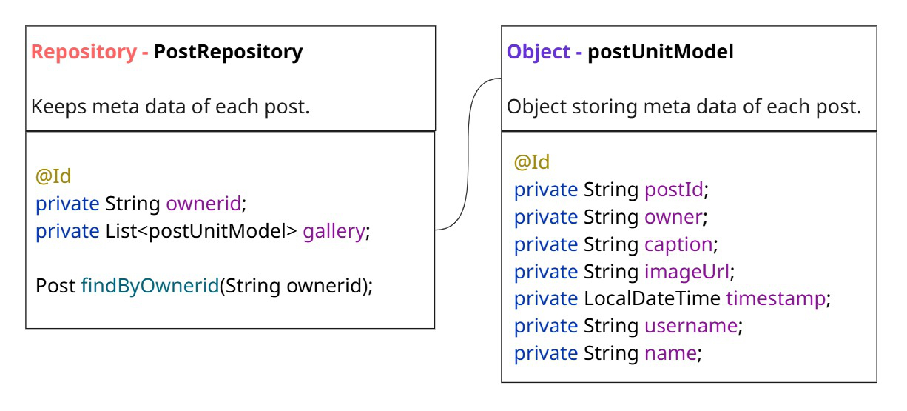 |
| **Connections Repository** | **Interaction Repository** |
| 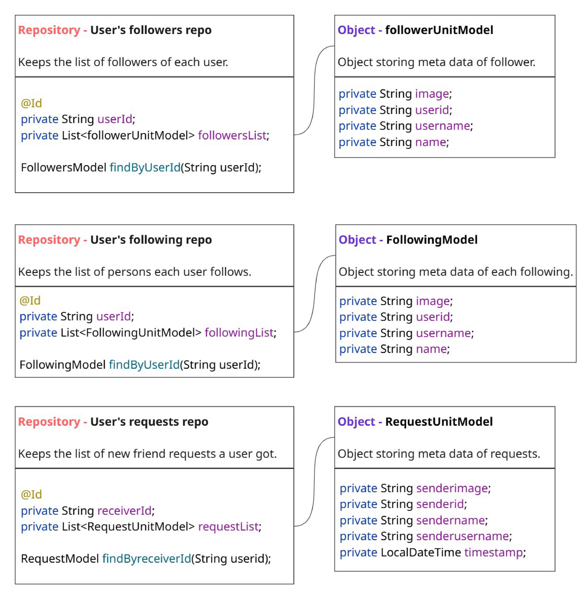 | 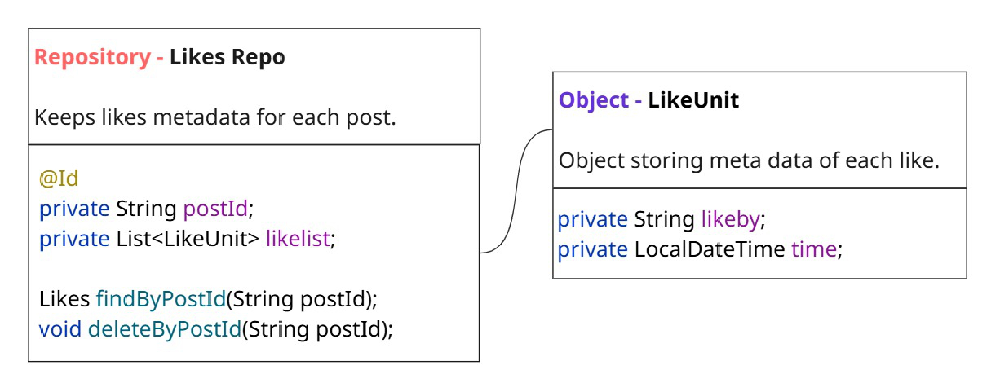 |

## ✨ Features & Screenshots

- Secure user authentication
- Create, edit and delete posts
- AWS S3 media storage
- Real-time chat using WebSockets
- Personalized feed generation
- Like, comment and follow system
- Real-time notifications
- User search and profile management

| Home | Search |
|:----:|:------:|
| 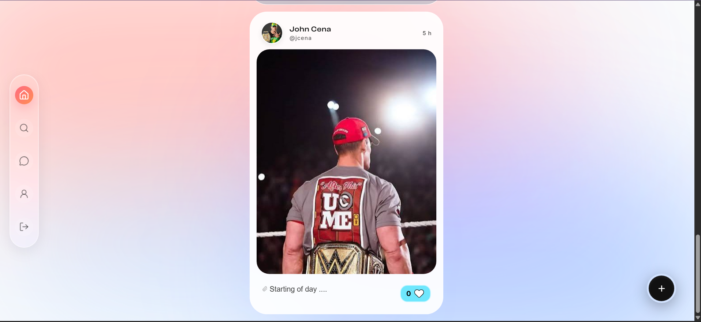 | 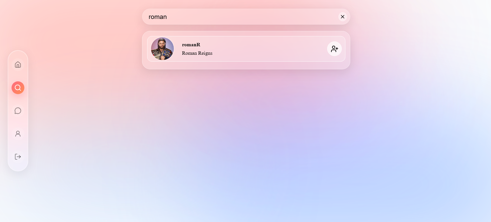 |
| **Message** | **Chat** |
| 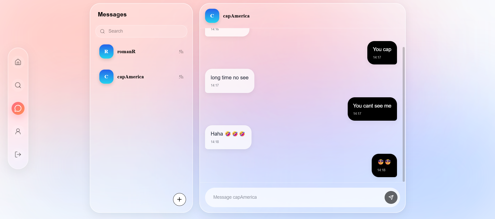 | 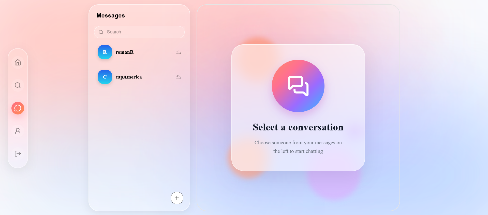 |
| **Post Details** | **Profile** |
| 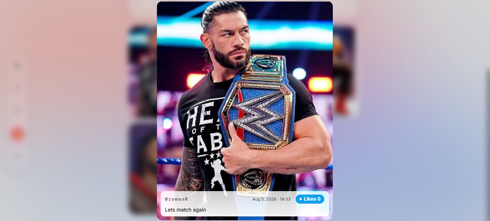 | 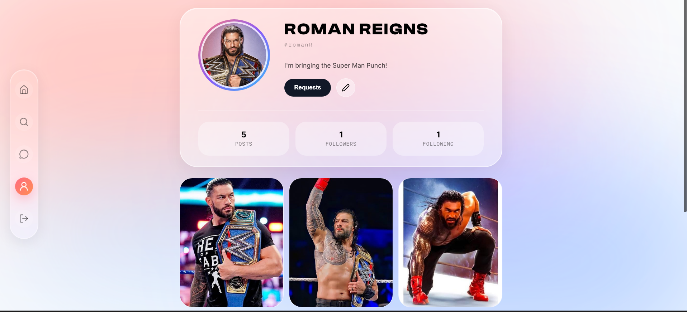 |

---

## 👨‍💻 Author

**Saurabh Tripathi** 

*M.Tech CSE '27, NIT Calicut*

Contact: **saurabh2002oct13@gmail.com**  

